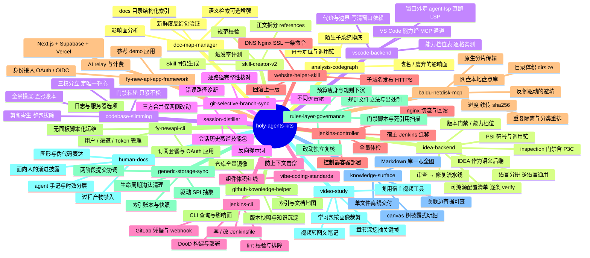

# holy-agents-kits

> 一组可直接加载的 Agent Skill：Jenkins 流水线与控制器、基于 new-api 的应用开发与命令行运维、代码图谱检索、IDEA 语义后端、VS Code / 语言服务器语义后端、选择性分支同步、规则层治理、文档内容管理、知识可视化、文档结构化索引与新鲜度验证、巨石代码库消肿与安全拔除、会话蒸馏成技能包、Vibe Coding 组件规范、子域名发布、百度网盘盘点与治理、GitHub 仓库本地知识管家、通用异构存储同步、Skill 本身怎么开发与校验。
> 一条命令装进你的 agent。

```bash
npx holy-agents-kits list
npx holy-agents-kits install jenkins-cli
```

## 技能一览



| Skill | 解决什么 | 你会怎么说 |
|---|---|---|
| `analysis-codegraph` | 按符号与调用链查代码，一次调用拿到源码与影响面 | 「这个函数谁在调」「改这个字段会影响哪」 |
| `idea-backend` | 把本机 IDEA 当 agent 的**多语言**语义后端：一段是「把项目接进 IDEA」（按语言分册：版本门禁、项目侧清单、IDE 侧设置、模板，每条带真跑的 verify 与官方出处），一段是「用 IDEA 的语义能力干活」（PSI 检索、inspection 门禁含阿里 P3C、审查 → 修复流水线、IDE 级重构与运行配置）。语言不是前提：装上对应插件就应对应语言，能到哪一档由能力矩阵判定并可探测 | 「用 IDEA 查这个符号」「按 P3C 审一遍」「这个仓怎么接进 IDEA」「tsconfig 改了 IDE 不生效」「社区版能不能跑 TS」 |
| `vscode-backend` | 把 VS Code 与语言服务器当 agent 的语义后端，多条腿并行用：借用 VS Code 自己的能力（BifrostMCP 原生 MCP 通道）、借用 VS Code 宿主聚合好的诊断与原生改名（vsc-lsp-mcp，给**全项目问题清单**与**全局改名落盘**）、不依赖窗口直跑 LSP（agent-lsp，给引用/影响面/改名）、以及直连语言服务器（仓内脚本，给**抽方法落盘**）。能力到哪一档以实测数字为准，每格都有出处 | 「用 VS Code 查这个符号」「这个仓的引用有哪些」「**这个仓有哪些问题**」「**改一个方法名全局一起改**」「**把这段抽成一个函数**」「关掉 VS Code 还能查吗」 |
| `git-selective-branch-sync` | 两个分支差距大时只搬指定部分，保住目标分支已有改动 | 「把这个分支的功能并过来，文档不要」 |
| `jenkins-cli` | 写/改/校验 Jenkinsfile，DooD 构建部署，接 GitLab | 「帮我写条流水线」「这个 Jenkinsfile 报错」 |
| `jenkins-controller` | 控制器容器的部署、迁移、切流、口令轮换、体检 | 「Jenkins 容器起不来」「切回宿主机」 |
| `fy-new-api-app-framework` | 用 new-api 做身份与 AI 网关，开发外部 Web 应用（含参考 demo） | 「用 new-api 做登录」「接 new-api 的计费和充值」 |
| `fy-newapi-cli` | 在终端运维 new-api：用户、渠道、Token、日志、套餐 | 「登进 new-api 看下渠道」「给它建个 API key」 |
| `rules-layer-governance` | 给 AGENTS.md / SKILL.md 这类规则文件做立法、瘦身、下沉门禁与独立复核 | 「AGENTS.md 太肥了」「把规则下沉成脚本门禁」 |
| `human-docs` | 文档按读者分离：给人看的表达层 + 给 agent 的记忆层 | 「写份给人看的文档」「这笔记下个上下文就忘了」 |
| `knowledge-surface` | 把 Markdown 文档库变成一眼全图 + 披露式明细的可探索界面 | 「把这堆文档做成脑图」「给我个能钻进去的知识图谱」 |
| `doc-map-manager` | 给 docs/ 建结构化索引（SQLite + 链接图谱 + 新鲜度评分），agent 检索文档的唯一入口：grab/lookup/语义搜索 + 影响面分析 | 「文档索引」「这篇文档被谁引用」「改它影响哪些文档」「语义搜索文档」 |
| `skill-creator-v2` | 开发、拆分、校验、评测 Skill 本身 | 「写一个 skill」「SKILL.md 太长」 |
| `codebase-slimming` | 巨石代码库消肿与安全拔除：全景摸底五张账本 → 三权分立定靶心 → 剪断寄生 → 整包拔除 → 门禁棘轮，数万行真实净减 | 「代码库太臃肿」「老代码整包下线」「死代码排查」「代码分布摸底」 |
| `session-distiller` | 从完整会话历史蒸馏可验证、可复用的技能包，附错误路径诊断与反向提示词 | 「把这次会话提炼成 skill」「蒸馏会话」「诊断 agent 反复道歉」 |
| `vibe-coding-standards` | AGENTS.md / Rules / Skills / Subagents 的结构规范与体积红线、防上下文击穿策略 | 「写 AGENTS.md 怎么组织」「skill 最多多少行」「防上下文击穿」 |
| `website-helper-skill` | 本地网页或已有后端发布到子域名（HTTPS 自动证书），DNS / Nginx / SSL 一条命令走完 | 「发布上线」「部署子域名」「更新网站」「回滚上一版」 |
| `baidu-netdisk-mcp` | 盘点并整理百度网盘：目录树灌进本地 SQLite 后做体量汇总、md5 重复检测、路径深度检查，再执行隔离/重排/索引；传输走百度原生分片协议（进度/速度/断点续传/sha256 校验） | 「网盘很乱」「网盘占了多少」「找重复文件」「整理网盘」「腾空间」「上传看不到进度」「大文件传到一半断了」 |
| `github-kownledge-helper` | 把 GitHub 仓库做成可检索的本地知识库：全量镜像 + 索引 + 文档地图，按需生成版本快照，沉淀讨论产出的知识；带 CLI 直接查仓、查索引、算影响面 | 「把这个仓的代码拉到本地」「这个仓有哪些文档」「这个改动会影响什么」「把这个仓的某个版本存下来」 |
| `generic-storage-sync` | 通用异构存储同步引擎：驱动 SPI 抽象（本地/网盘/云盘各写一份即可接入）、索引账本、两阶段提交协调器、快照生命周期淘汰与安全清理；物理删除只有一个出口且需显式确认 | 「把这些东西同步到网盘」「同步失败了怎么续上」「旧快照什么时候能清」「接一个新介质怎么写驱动」 |
| `video-study` | 把一个视频（课程/技术分享/讲座/教程/播客）加工成可直接用的学习材料：转写+全片采样摸底 → 按章节深挖关键段并抽关键帧 → 图文笔记 note.md + 按学习者画像裁剪的学习包 study/（导航、原理深挖、术语速查必产，概念迁移表、题库、验收标准、前置清单按需组合）；机械层复用宿主已有视频工具，不剪辑不渲染 | 「视频学习」「看视频学」「整理视频笔记」「视频转学习包」「这个视频讲了什么」 |

两个 Jenkins 技能互为边界：`jenkins-cli` 只管流水线，`jenkins-controller` 只管控制器本身，触发时不会互相抢。
两个 new-api 技能同样分工：`fy-new-api-app-framework` 管「在 new-api 外面写应用」，`fy-newapi-cli` 管「运维已经在跑的 new-api」。
两个文档治理技能也是一对：`rules-layer-governance` 只治规则文件（AGENTS.md / SKILL.md / 章程）的立法与下沉，`human-docs` 管普通文档怎么写、agent 手记怎么记。
两个存储技能也是一对，但**零代码耦合**：`github-kownledge-helper` 只管仓库收录与知识沉淀，`generic-storage-sync` 只管介质上的快照与生命周期，跨技能调用只留命令指针（管家技能侧路径走 `$GSS` 变量，两种安装位置都对）。

## 安装

```bash
# 查看可安装的 skill
npx holy-agents-kits list

# 安装指定 skill（默认装到 ~/.agents/skills）
npx holy-agents-kits install jenkins-cli

# 一次装多个
npx holy-agents-kits install jenkins-cli jenkins-controller

# 装到当前项目，而不是用户目录
npx holy-agents-kits install jenkins-cli --dir .agents/skills

# 已存在时覆盖
npx holy-agents-kits install jenkins-cli --force
```

| 参数 | 作用 |
|---|---|
| `--dir <path>` | 安装目录，默认 `~/.agents/skills` |
| `--force` | 目标已存在时覆盖 |
| `list` | 列出全部 skill 与一句话说明 |
| `feedback` | 打印 issue 上报入口与必填信息 |

安装完即生效：agent 读取 `SKILL.md` 的 `description` 判断是否加载，不需要额外注册。安装时会在目标目录根下写入一份 `FEEDBACK.md`，让 agent 知道反馈该提到哪。

**卸载**：删除 `~/.agents/skills/<skill-name>` 目录即可。安装器不会写注册表，不会留残留。

## 二十一个技能分别做什么

### analysis-codegraph —— 按符号查代码

**可观察行为**：一次查询返回按文件分组的源码、调用关系与影响面；能定位符号、追调用链、评估改名或删除的波及范围。

**用法**：说「这个函数谁在调」「改这个接口会影响哪些地方」，agent 调 codegraph 查询，而不是反复 Grep + Read。

**边界**：要求仓库已装 codegraph 并建好索引（`.codegraph/`）；git 历史、文档、配置文件和字面量搜索不走它。

### idea-backend —— 把本机 IDEA 当 agent 的多语言语义后端

**可观察行为**：分两段用同一套机器事实。**接进 IDEA**（配置侧）：按语言分册给出可执行清单，每条带**真跑**的 `verify` 与官方文档出处 —— 已建册：TS/JS（64 条，真实大型 Next.js + pnpm 仓库回归过一轮）、JVM（检视侧）、Python（建册中）；分册探测器判项目形态并筛出适用条目。**调 IDEA 能力**（运行侧）：调用本机 IDEA 的两个 MCP server（内置 + Index 插件）做 PSI 语义检索与 inspection 检视——按符号取定义/引用/调用链，按范围批检视并产出 XML 清单；再按「审查 → 修复」流水线把清单按文件边界分簇、精确投递给子代理修完，避免整组返工。新能力按固定扩展模式（给 MCP 插件加一个工具）继续长进来。

**用法**：说「用 IDEA 查一下这个符号」「按 P3C 规范审一遍，改完再验一遍」，agent 走 `scripts/audit-baseline.sh` 拿基线清单 → 分簇派发修复 → `scripts/inspect-diff.sh` 复检；说「这个仓怎么接进 IDEA」，agent 走 `scripts/inspect-project.mjs` 判语言与形态 → 按语言分册逐条落配置 → `scripts/verify-item.sh --lang <lang> --all` 逐条自证。

**边界**：**语言不是前提，档位才是** —— 装上对应插件就能用这门语言，但支持到哪一档由「IDE 版本 + 插件栈 + 插件构建」共同决定，逐档可探测（档位定义与探测判据见技能内 `references/capability-matrix.md`）。例如 TS/JS 与 Python 的**语言插件**在社区版都装不了（Marketplace 兼容列表只有 `IDEA_PRO`），只能换 Ultimate/WebStorm/PyCharm；而 Go 语言插件、Ruff 这类**工具插件**社区版可装 —— **门禁是每个插件一行，不是每门语言一行**。需要本机装好 IDEA 2026.2.5（社区版）与 MCP server；P3C / Lombok / Index 插件按语言分册需要什么就装什么，机器事实由技能内 `setup-env.sh` 探测写入本地 `config.json`（不入库、不分发）。P3C 的 65 条规则里只有 11 条能经 MCP 驱动，其余需走 GUI 或 PMD CLI。**工具面随插件版本变**：上游版只有 16 个工具（没有 `ide_inspect`），流水线会自动降级到文件级检视，权威判据是 `mcp-call.sh list index`。

> **迁移说明（2026-11-20）**：原独立的 `idea-ts-setup` 技能已并入本技能，成为 **TS / JavaScript 语言分册**（`skills/idea-backend/references/langs/ts/`）：清单、模板、探测器、引文快照原样保留，路径改为分册目录；`setup-env.sh` 两个脚本合并为一个（机器事实只有一份），`inspect-project.mjs` 改为通用分发器（按 marker 判语言 → 调该语言分册探测器 → 过滤该语言清单）。命令变化：`bash scripts/verify-item.sh --all` → `bash scripts/verify-item.sh --lang ts --all`；`scripts/init-ts-project.sh` → `scripts/init-project.sh --lang ts`。已经装过 `idea-ts-setup` 的机器请删掉那份（`rm -rf ~/.agents/skills/idea-ts-setup`）并重装 `idea-backend`。

### git-selective-branch-sync —— 只搬该搬的那部分

**可观察行为**：三方合并保住目标分支的既有改动；不迁的部分进入台账可核对；迁移后用逐路径比对证明「该迁的都迁了、不该迁的没动」。

**用法**：说「把 A 分支的功能并到 B，那些文档不要」，agent 列清单、跑三方合并、核对完整性。

**边界**：两个分支必须在同一个 git 仓库里；跨仓库搬运不适用。

### jenkins-cli —— 流水线怎么写

**可观察行为**：让 agent 产出结构完整、能过 lint 的 Jenkinsfile；判断 lint 告警该不该修；按症状定位流水线故障。

**用法**：直接说需求（「写条拉 GitLab 代码、构建镜像、部署到 dev 的流水线」），agent 会选型、套模板、跑校验。

**边界**：控制器容器本身的问题不归它管；K8s、云厂商托管 Jenkins、插件开发不在范围内。

### jenkins-controller —— 控制器容器的生命周期

**可观察行为**：五个阶段（prepare / migrate / deploy / switch / finalize）可单独重跑；每次判断都落到真实断言——容器 healthy、匿名 403、登录 200、上游指向新端口。

**用法**：说「部署一套带账密的 Jenkins」「把宿主 Jenkins 迁到容器」「切回宿主」，agent 调对应脚本；先 `--dry-run` 看计划。

**边界**：写流水线、改 Jenkinsfile 用 `jenkins-cli`。

### fy-new-api-app-framework —— 用 new-api 做身份与 AI 网关

**可观察行为**：产出一套可运行的外部 Web 应用——new-api 登录（OAuth 2.0 / OIDC）、AI relay 调用、配额与充值/订阅计费，附带一份 Next.js + Supabase + Vercel 的参考 demo（虚拟试衣）。

**用法**：说「用 new-api 做登录和计费，搭个外部 Web 应用」，agent 会先读身份与计费契约，再按默认技术栈落地；换栈时契约仍然有效。

**边界**：new-api 自身的后台功能不在这里改；默认栈（Next.js / Supabase / Vercel）只是默认值，不是强制项。

### fy-newapi-cli —— new-api 的终端运维

**可观察行为**：用一条命令管理运行中的 new-api——登录、看/改用户、渠道、API Token、日志、服务器选项、订阅套餐、OAuth 应用；也能给 agent 建 API key，或把管理 API 脚本化。

**用法**：说「登进 new-api 看下渠道状态」「给我建个 API key」，agent 用 `fy-newapi-cli` 直连管理 API（服务器地址 + `nap_` 开头的个人访问令牌）。

**边界**：不改 new-api 源码，不直接碰数据库；这些问题交给应用开发技能或 new-api 本身的技能。

### rules-layer-governance —— 规则文件本身的立法与瘦身

**可观察行为**：产出有出处、有模板、有门禁的规则文件——存量的来源查不到就写「存量-未溯源」，不编造；能脚本验证的规则下沉成 `scripts/gates/<编号>.sh`，正文只留一行指针且编号不动；改动由独立复核的三向语义保真校验器背书，不采信执行方自检。

**用法**：说「AGENTS.md 太长了」「把规则下沉成脚本门禁」，agent 走 6 步流程（盘点 → 立法 → 模板化 → 下沉 → 复核 → 记账），立法那步须人批准后才生效。

**边界**：只治规则文件本身；代码规范怎么写归项目自己的技能，经验记账不归它。

### human-docs —— 文档按读者分离

**可观察行为**：文档分两层——面向人的表达层（渐进披露、图形与伪代码、过程产物禁入、单一事实来源）与面向 agent 的记忆层（DAG 任务表、分层索引地图、临时 todos、冻结/活跃/临时时效分层与「用完即焚」）。落地时附一份机器自检清单：禁词扫描靠脚本，不靠自觉。

**用法**：说「写份给用户看的文档」「这些笔记留到下个上下文就忘了」，agent 先按读者选层，再检查正文里有没有混进只有开发过程的人才懂的记号。

**边界**：不管文档内容的正确性，也不替项目决定文档放哪；它管的是表达方式与记忆结构。

### knowledge-surface —— 文档库变成一眼全图的可探索界面

**可观察行为**：一条命令把 Markdown 目录构建成单文件 HTML（数据内嵌、双击即开）——canvas 树布局、分组配色、hover 出一句话摘要、点开见渲染后的全文、Esc 关闭；关联边只由共享概念词推出，位置关系的边明确标注「同文件相邻」；自带构建自检（摘要缺失、孤儿节点必须为 0）。

**用法**：说「把这堆文档做成能点的知识图谱」，agent 先盘结构写 `surface.config.json`（分组 / 摘要段），再跑 `scripts/build_surface.mjs`，按 QA 清单全图体检 + 披露体检后交付。

**边界**：只管「结构 → 图 → 披露」的呈现范式；不做检索索引、不产出内容。语料超过 800 节点要按组拆多张图，不是硬塞一张画布。

### vscode-backend —— 把 VS Code 与语言服务器当语义后端

**可观察行为**：两条腿并行用 —— ① 窗口开着时借 VS Code 自己的能力（BifrostMCP 扩展的原生 MCP 通道：定义/引用/工作区符号/文档符号/语义 token）；② 窗口关着也能查（agent-lsp 直跑 LSP：引用/单文件诊断/改名删除前的影响面）。能力按 L0-L5 档位逐格实测，数字与凭证入库可对账；没有的能力写清「无此能力 + 可核对的来源」。

**用法**：说「这个仓里谁在调这个符号」「关掉 VS Code 还能查吗」「改名会影响哪些文件」「**这个仓有哪些问题**」「**把这段抽成一个函数**」，agent 走 `skills/vscode-backend/references/runtime.md` 的档位表选腿，再按 `setup.md` 装好对应通道（`install-vscode-mcp.sh` 生成 `.mcp.json`；agent-lsp 的 server spec 必须带 `,--stdio`；全项目清单与改名落盘要装 `CJL.lsp-mcp` 扩展；抽方法用仓内 `scripts/lsp-refactor.mjs`）。

**边界**：要 VS Code 窗口开着的那条腿，诊断与改名两个工具在扩展 0.0.14 实测是坏的；窗口外那条腿的诊断单文件要 25 秒。全项目批检视是协议级缺口（LSP 没有 scope 参数）。

### skill-creator-v2 —— 技能本身的开发与评测

**可观察行为**：生成技能骨架（`--runtime node/python/uv`，脚本模板自带 .env 三级查找、BOM 兼容与 stdout 单行 JSON 契约）；把超长正文拆到 `references/` 并在原处留指针；跑规范校验（行数、frontmatter、引用完整性、代码外泄、.env 密钥泄漏）；按反馈迭代 `description`。

**用法**：说「写一个 skill」「SKILL.md 太长」「校验一下这个技能」，agent 会调用技能自带的脚本。

**边界**：不生产业务技能的内容，只提供生产技能的方法。

### codebase-slimming —— 巨石代码库消肿与安全拔除

**可观察行为**：产出互斥四桶、src 分域排行、巨型模糊桶二阶下钻、跨域依赖矩阵、死代码可达闭包等五张全景账本；按三权分立锁定唯一拔除靶心；先在新端内建自包含组件剪断寄生引用，再对老地层整包物理拔除（UI + API 路由 + 专属测试），最后用增量门禁棘轮锁死，`git diff --stat` 数万行真实净减。

**用法**：说「代码库太臃肿」「老代码整包下线」「死代码排查」「代码分布摸底」，agent 先出摸底账本，再走四步拔除闭环。

**边界**：只管巨石治理主线（摸底 → 分立 → 拔除 → 棘轮），不做单模块小型重构与性能优化；语义判定（引用 / 诊断 / 影响面）委托 `vscode-backend`；提炼自单项目复盘，比例数字仅作量级先验。

### session-distiller —— 会话蒸馏成技能包

**可观察行为**：从完整会话历史中蒸馏出可验证、可复用、非空泛的技能包（SKILL.md + references + templates）；做去重检查、错误路径诊断（反复道歉 → 反向提示词）、输入端情绪中性化与温度值（保留严重程度信号）。

**用法**：说「把这次会话提炼成 skill」「蒸馏会话」「诊断 agent 反复道歉」，agent 按会话历史产出技能包并过校验。

### vibe-coding-standards —— Vibe Coding 组件编写规范

**可观察行为**：给出 AGENTS.md、Rules、Skills、Subagents 的结构规范、体积上限（AGENTS.md 200 行 / Rule 120 行 / SKILL.md 150 行 / Subagent 200 行 / references 300 行）与防上下文击穿策略。

**用法**：说「写 AGENTS.md」「写规则」「编写 skill」「写子代理」「防上下文击穿」。

### baidu-netdisk-mcp —— 百度网盘的盘点与治理

把网盘目录树灌进**本地 SQLite**，之后所有分析（体量汇总、md5 重复检测、路径深度、重复副本）
都是本地查询，不再反复打网盘接口。治理动作走「隔离 → 重排 → 索引」三步，
全部是服务端 move，可逆。

- **目录体积用网盘自己的 `dirsize` 接口**，不要自己枚举文件累加 —— 深层树上枚举会少算一半
- **传输走百度原生分片协议**（precreate → 分片 → 建档），不是黑盒 CLI：
  每片一个进度刻度、实时速度与 ETA、**服务端驱动的断点续传**（它告诉你还缺哪几片）、
  sha256 端到端校验；同一远端路径并发上传有锁保护
- **哈希分两级**：片级用标准 md5（对齐百度 `block_list` 协议），文件级用 sha256 记我们自己的账；
  网盘返回的 md5 是**闭源变种**（≠ 标准 md5），只当身份标识、不参与本地校验
- **反例清单**带路：分页每页 10 条、`make_dir` 默认重命名、`file_move` 的 async 语义等 27 个已踩过的坑
- 盘点器（`scripts/baidu-netdisk-db.mjs`）+ 移动器（`scripts/baidu-netdisk-move.mjs`）+
  传输层（`scripts/transfer.mjs`）零依赖

### website-helper-skill —— 子域名发布

**可观察行为**：自带 publish CLI，把本地网页或已有后端发布到子域名（HTTPS 自动证书），DNS / Nginx / SSL 一条命令走完；也能给反代后端挂域名，支持更新与回滚上一版。

**用法**：说「发布上线」「部署子域名」「更新网站」「回滚上一版」「续签证书」。

**边界**：凭据只从仓库根 `.agents/.env` 读取，绝不回显。

### doc-map-manager —— 文档结构化索引与新鲜度验证

**可观察行为**：为 docs/ 目录构建 SQLite 索引（标题/章节行号/面包屑 + 链接图谱 + 标签 + 新鲜度评分）；agent 用 `--grab`/`--lookup` 毫秒级取正文、`--context-mode` 查入站/出站链接、`--impact` 做修改前影响面分析、`--detect-changes` 找需要同步的关联文档；语义检索（ChromaDB/Zvec）可选增强，缺失自动降级标准库。

**用法**：说「文档索引」「这篇文档被谁引用」「改它影响哪些文档」「语义搜索文档」，agent 建索引后按问题选 grab/lookup/impact。

**边界**：只管「建索引 + 查询 + 新鲜度/影响面」，给人看的可视化全图走 `knowledge-surface`，代码符号图走 `analysis-codegraph`；索引库 SQLite 禁止直接 Read，必须走 `query-index.py`。

### github-kownledge-helper —— 本地 GitHub 仓库管家

> **拼写锚**：`kownledge` 是历史拼写（目录名 = 安装名，自 registry 0.15.0 起已发布），**不要**修正为 `knowledge`——改名会断已装用户的安装路径与全部引用；见到这个"错拼"保持原样。

**可观察行为**：把第三方仓库收录成可检索的本地知识库——完整克隆进 `repos/`、同步顶层文档到 `docs/`、建索引与文档地图、原子维护 `manifest.json` 唯一事实源；`query` 走本地 git 实测回答 commit / tag / 版本号问题并附新鲜度标注（🟢/🟡/🔴）；`sync-to` 可把单个仓镜像到任意绝对路径（含 `.git`）。

**用法**：说「把这个仓收录进来」「这仓最近动了什么」「这仓有哪些文档」「把 X 仓镜像到 D 盘」，agent 走 CLI（`add` / `update` / `update-all` / `query` / `query-all` / `sync-manifest` / `sync-docs` / `verify-docs` / `sync-to`）。

**边界**：只读追踪，**绝不改第三方仓库源码**（除非显式要求 patch）；本机路径一律走项目根 `.agents/.env`，正文与代码零硬编码；跨介质快照归档交给 `generic-storage-sync`，本技能只出指针不直接调介质。

### generic-storage-sync —— 通用异构存储同步

**可观察行为**：介质透明的快照引擎——`pack` 把仓库打成 git bundle + SHA-256 进缓冲盘，`push` 两阶段提交推到介质（物理盘 / 挂载盘 / SFTP / SMB / 网盘），`pull` 拉回还原；索引账本只记每仓当前版本，历史版本以介质目录为准；`diff` 出漂移清单（toUpload / toTrash / upToDate），`prune` 淘汰超量旧版本，`clean-trash` 回收冷却期满的残卷。新介质只需按驱动 SPI 继承 `BaseDriver` 并跑合规套件。

**用法**：说「把这个仓备份到网盘」「同步断了怎么续」「旧快照什么时候能清」「接夸克网盘怎么写驱动」，agent 走 `scripts/sync_cli.mjs`（`target` / `pack` / `push` / `pull` / `status` / `diff` / `prune` / `clean-trash` / `clean-staging`）。

**边界**：**物理删除只有一个出口**——`clean-trash --yes` 且冷却期满（窗口 `[0, TTL)`，恰好等于 TTL 即到期）才真正删文件，其它路径一律软删除进 `.trash/`；`prune` 与 `clean-trash` 默认 dry-run，只报清单与可释放字节数。索引 schema 的唯一事实源是 `index_store.mjs`，驱动层只做字节透传。

### video-study —— 视频学习加工

**可观察行为**：把一个视频（课程/技术分享/讲座/教程/播客）加工成可直接用的学习材料：转写+全片采样摸底 → 按章节深挖关键段并抽关键帧 → 产出图文笔记 `note.md` 与结构化学习包 `study/`（必产导航、逐主题原理深挖、术语速查；选配概念迁移表、题库、动手验收标准、前置知识清单）。每个数字标时间戳可溯源，`[填空]` 标出必须学习者本人补真实经历的位置。时间戳来源按「画面编号卡/烧录字幕 > 转写自带时间轴」取，交付前跑 `scripts/check-output.py` 自检四类机械项。

**用法**：说「视频学习」「看视频学」「整理视频笔记」「视频转学习包」「这个视频讲了什么」，agent 先问学习者画像（背景/目标/缺口），再走五步：立档 → 摸底 → 深挖 → 笔记 → 学习包 → 自检交付。画像只影响选配模块，必产三件可先开工。

**边界**：机械层复用宿主已有视频工具（video-agent-kit / video2code / 宿主自带多模态 ASR / ffmpeg 降级），既无 ASR 又无字幕文件才停下报告，不手搓 ASR；不做剪辑渲染，不管出题评分训练循环。

## 仓库结构

```
holy-agents-kits/
├── skills/
│   ├── analysis-codegraph/         SKILL.md + references/
│   ├── idea-backend/               SKILL.md + references/（含 langs/<语言> 分册）+ scripts/（含 langs/<语言>）+ templates/
│   ├── vscode-backend/             SKILL.md + references/（含 measurements/）+ scripts/
│   ├── git-selective-branch-sync/  SKILL.md + references/ + scripts/
│   ├── jenkins-cli/                SKILL.md + references/ + scripts/
│   ├── jenkins-controller/         SKILL.md + references/ + scripts/
│   ├── fy-new-api-app-framework/   SKILL.md + references/（含参考 demo）+ scripts/
│   ├── fy-newapi-cli/              SKILL.md
│   ├── rules-layer-governance/     SKILL.md + references/ + templates/
│   ├── human-docs/                 SKILL.md + references/
│   ├── knowledge-surface/          SKILL.md + references/ + scripts/ + assets/
│   ├── doc-map-manager/            SKILL.md + references/ + scripts/
│   ├── skill-creator-v2/           SKILL.md + references/ + scripts/ + assets/templates/
│   ├── codebase-slimming/          SKILL.md + references/（含实证案例库）
│   ├── session-distiller/          SKILL.md + references/ + scripts/ + templates/ + examples/
│   ├── vibe-coding-standards/      SKILL.md + references/ + scripts/
│   ├── website-helper-skill/       SKILL.md + publish CLI + scripts/ + tests/ + references/
│   ├── baidu-netdisk-mcp/          SKILL.md + references/ + scripts/（网盘点库 + 移动器 + 传输层）
│   ├── github-kownledge-helper/    SKILL.md + references/ + scripts/（CLI + 库 + 命令 + 测试）
│   ├── generic-storage-sync/       SKILL.md + references/ + SPEC.md + scripts/（驱动 + 协调器 + 生命周期 + CLI）
│   └── video-study/                SKILL.md + references/（工具对照 + 笔记格式 + 学习包规范）+ scripts/（产物自检）
├── bin/cli.js                      安装器（零依赖）
├── FEEDBACK.md                     issue 上报入口与必填信息
└── package.json
```

## 反馈

技能由 agent 直接执行，写错、缺步骤、命令跑不通，直接开 issue，不用先问维护者：

```bash
# 打开 issue 页
https://github.com/monsterbude123/holy-agents-kits/issues/new

# 或者让安装器把入口和必填项打出来
npx holy-agents-kits feedback
```

这个入口跟着技能走，其他机器上的 agent 也能看到：

- 每个 `SKILL.md` 末尾有一行仓库级反馈入口，技能被复制到哪都带着它
- 安装器每次安装都会打印入口，并在安装目录根下写一份 `FEEDBACK.md`
- `list` 与 `feedback` 命令都会打印入口

标题前缀写技能名（如 `[git-selective-branch-sync]`），跨技能问题写 `[kit]`。正文写清：哪份文件、任务原话、实际报错原文、期望结果、环境。不要贴凭据、token、内网地址或私有代码。

完整说明见 [FEEDBACK.md](FEEDBACK.md)。

## 前提与边界

- 两个 Jenkins 技能里的脚本面向真实环境：需要 Docker、SSH 可达的服务器、`test-190/jenkins` 部署包。没有环境时可以先读 `references/` 里的做法与排障表。
- 两个 new-api 技能需要一个已经部署好的 new-api 实例；`fy-newapi-cli` 还要一条 `nap_` 开头的个人访问令牌。参考 demo 需要 Node.js、Supabase 与 Vercel 账号。
- `analysis-codegraph` 需要目标仓库已装 codegraph 并建好索引；没有索引时按技能内的降级路径处理。
- `idea-backend` 需要本机装好 IDEA 2026.2.5（社区版）与 MCP server；**用什么语言还要装对应插件**（P3C / Lombok / Index 插件按语言分册需要什么就装什么，社区版装不了的语言插件要换 Ultimate/WebStorm 等对应产品）；机器事实由技能内 `setup-env.sh` 探测并写入本地 `config.json`（不入库、不分发），没有 IDEA 时只能读 `references/` 里的做法。
- `git-selective-branch-sync` 针对同一仓库内的两个分支，跨仓库搬运不适用。
- `vscode-backend` 需要本机装好 VS Code（BifrostMCP 扩展 + `CJL.lsp-mcp` 扩展）与语言服务器（agent-lsp + typescript-language-server + TypeScript 5.x）；窗口开着那条腿依赖 VS Code 窗口活着，窗口外那条腿不需要；机器事实写在技能内的 `config.json`（不入库、不分发），`.mcp.json` 由安装脚本生成。
- `skill-creator-v2` 的触发率评测脚本依赖 `claude` CLI；本机没有时走人工跑用例的降级路径，技能里写明了。
- `rules-layer-governance`、`human-docs`、`codebase-slimming`、`session-distiller`、`vibe-coding-standards` 与 `doc-map-manager` 是纯方法论/自带脚本技能，不需要外部服务或凭据；`rules-layer-governance` 的门禁脚本由技能内的 `templates/` 生成，落到项目里再按项目自己的路径改；`codebase-slimming` 的语义判定委托 `vscode-backend` 技能；`doc-map-manager` 需要 Python ≥ 3.9（精确查询仅标准库，语义检索为可选增强依赖）。
- `website-helper-skill` 需要一台可部署的服务器与可控 DNS 的域名（HTTPS 证书自动申请）；凭据只从仓库根 `.agents/.env` 读取，绝不回显。
- `knowledge-surface` 的构建脚本零依赖，只需 Node ≥ 18；`--echarts` 指定本地 `echarts.min.js` 则产物离线自包含，不给则走 CDN（需联网打开）。
- `github-kownledge-helper` 需要 Node ≥ 22（零构建、零 npm 依赖，只用内置模块）与 git；本机路径、目录布局等机器事实一律读项目根 `.agents/.env`（真实 `.env` 不入库，只有 `.env.example` 模板）。技能装到用户项目后，`repos/` `docs/` `manifest.json` 是**使用者项目的数据**，不随技能分发。
- `generic-storage-sync` 需要 Node ≥ 18 与可写的缓冲盘；介质端点、保留策略、TTL 全部走项目根 `.agents/.env`。第三方网盘驱动（百度 / 夸克）由对应 Agent 按驱动 SPI 实现并接入，必须跑通技能自带的合规套件；没有自定义驱动时用内置本地驱动即可跑通全链路。
- 本仓库只放技能与方法，不含业务代码、部署包和任何真实凭据。

## 许可

MIT
