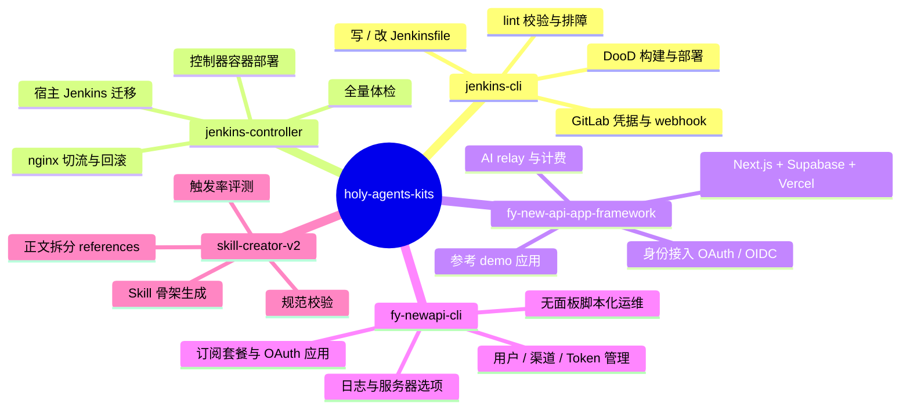

# holy-agents-kits

> 一组可直接加载的 Agent Skill：Jenkins 流水线与控制器、基于 new-api 的应用开发与命令行运维、Skill 本身怎么开发与校验。
> 一条命令装进你的 agent。

```bash
npx holy-agents-kits list
npx holy-agents-kits install jenkins-cli
```

## 技能一览



| Skill | 解决什么 | 你会怎么说 |
|---|---|---|
| `jenkins-cli` | 写/改/校验 Jenkinsfile，DooD 构建部署，接 GitLab | 「帮我写条流水线」「这个 Jenkinsfile 报错」 |
| `jenkins-controller` | 控制器容器的部署、迁移、切流、口令轮换、体检 | 「Jenkins 容器起不来」「切回宿主机」 |
| `fy-new-api-app-framework` | 用 new-api 做身份与 AI 网关，开发外部 Web 应用（含参考 demo） | 「用 new-api 做登录」「接 new-api 的计费和充值」 |
| `fy-newapi-cli` | 在终端运维 new-api：用户、渠道、Token、日志、套餐 | 「登进 new-api 看下渠道」「给它建个 API key」 |
| `skill-creator-v2` | 开发、拆分、校验、评测 Skill 本身 | 「写一个 skill」「SKILL.md 太长」 |

两个 Jenkins 技能互为边界：`jenkins-cli` 只管流水线，`jenkins-controller` 只管控制器本身，触发时不会互相抢。
两个 new-api 技能同样分工：`fy-new-api-app-framework` 管「在 new-api 外面写应用」，`fy-newapi-cli` 管「运维已经在跑的 new-api」。

## 安装

```bash
# 查看可安装的 skill
npx holy-agents-kits list

# 安装指定 skill（默认装到 ~/.agents/skills）
npx holy-agents-kits install jenkins-cli

# 一次装多个
npx holy-agents-kits install jenkins-cli jenkins-controller

# 装到当前项目，而不是用户目录
npx holy-agents-kits install jenkins-cli --dir .agents/skills

# 已存在时覆盖
npx holy-agents-kits install jenkins-cli --force
```

| 参数 | 作用 |
|---|---|
| `--dir <path>` | 安装目录，默认 `~/.agents/skills` |
| `--force` | 目标已存在时覆盖 |
| `list` | 列出全部 skill 与一句话说明 |

安装完即生效：agent 读取 `SKILL.md` 的 `description` 判断是否加载，不需要额外注册。

**卸载**：删除 `~/.agents/skills/<skill-name>` 目录即可。安装器不会写注册表，不会留残留。

## 五个技能分别做什么

### jenkins-cli —— 流水线怎么写

**可观察行为**：让 agent 产出结构完整、能过 lint 的 Jenkinsfile；判断 lint 告警该不该修；按症状定位流水线故障。

**用法**：直接说需求（「写条拉 GitLab 代码、构建镜像、部署到 dev 的流水线」），agent 会选型、套模板、跑校验。

**边界**：控制器容器本身的问题不归它管；K8s、云厂商托管 Jenkins、插件开发不在范围内。

### jenkins-controller —— 控制器容器的生命周期

**可观察行为**：五个阶段（prepare / migrate / deploy / switch / finalize）可单独重跑；每次判断都落到真实断言——容器 healthy、匿名 403、登录 200、上游指向新端口。

**用法**：说「部署一套带账密的 Jenkins」「把宿主 Jenkins 迁到容器」「切回宿主」，agent 调对应脚本；先 `--dry-run` 看计划。

**边界**：写流水线、改 Jenkinsfile 用 `jenkins-cli`。

### fy-new-api-app-framework —— 用 new-api 做身份与 AI 网关

**可观察行为**：产出一套可运行的外部 Web 应用——new-api 登录（OAuth 2.0 / OIDC）、AI relay 调用、配额与充值/订阅计费，附带一份 Next.js + Supabase + Vercel 的参考 demo（虚拟试衣）。

**用法**：说「用 new-api 做登录和计费，搭个外部 Web 应用」，agent 会先读身份与计费契约，再按默认技术栈落地；换栈时契约仍然有效。

**边界**：new-api 自身的后台功能不在这里改；默认栈（Next.js / Supabase / Vercel）只是默认值，不是强制项。

### fy-newapi-cli —— new-api 的终端运维

**可观察行为**：用一条命令管理运行中的 new-api——登录、看/改用户、渠道、API Token、日志、服务器选项、订阅套餐、OAuth 应用；也能给 agent 建 API key，或把管理 API 脚本化。

**用法**：说「登进 new-api 看下渠道状态」「给我建个 API key」，agent 用 `fy-newapi-cli` 直连管理 API（服务器地址 + `nap_` 开头的个人访问令牌）。

**边界**：不改 new-api 源码，不直接碰数据库；这些问题交给应用开发技能或 new-api 本身的技能。

### skill-creator-v2 —— 技能本身的开发与评测

**可观察行为**：生成三段式技能骨架；把超长正文拆到 `references/` 并在原处留指针；跑规范校验（行数、frontmatter、引用完整性、代码外泄）；按反馈迭代 `description`。

**用法**：说「写一个 skill」「SKILL.md 太长」「校验一下这个技能」，agent 会调用技能自带的脚本。

**边界**：不生产业务技能的内容，只提供生产技能的方法。

## 仓库结构

```
holy-agents-kits/
├── skills/
│   ├── jenkins-cli/                SKILL.md + references/ + scripts/
│   ├── jenkins-controller/         SKILL.md + references/ + scripts/
│   ├── fy-new-api-app-framework/   SKILL.md + references/（含参考 demo）+ scripts/
│   ├── fy-newapi-cli/              SKILL.md
│   └── skill-creator-v2/           SKILL.md + references/ + scripts/
├── bin/cli.js                      安装器（零依赖）
└── package.json
```

## 前提与边界

- 两个 Jenkins 技能里的脚本面向真实环境：需要 Docker、SSH 可达的服务器、`test-190/jenkins` 部署包。没有环境时可以先读 `references/` 里的做法与排障表。
- 两个 new-api 技能需要一个已经部署好的 new-api 实例；`fy-newapi-cli` 还要一条 `nap_` 开头的个人访问令牌。参考 demo 需要 Node.js、Supabase 与 Vercel 账号。
- `skill-creator-v2` 的触发率评测脚本依赖 `claude` CLI；本机没有时走人工跑用例的降级路径，技能里写明了。
- 本仓库只放技能与方法，不含业务代码、部署包和任何真实凭据。

## 许可

MIT
