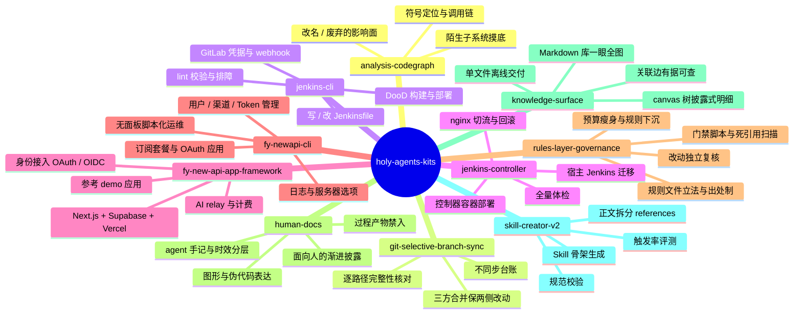

# holy-agents-kits

> 一组可直接加载的 Agent Skill：Jenkins 流水线与控制器、基于 new-api 的应用开发与命令行运维、代码图谱检索、选择性分支同步、规则层治理、文档内容管理、知识可视化、Skill 本身怎么开发与校验。
> 一条命令装进你的 agent。

```bash
npx holy-agents-kits list
npx holy-agents-kits install jenkins-cli
```

## 技能一览



| Skill | 解决什么 | 你会怎么说 |
|---|---|---|
| `analysis-codegraph` | 按符号与调用链查代码，一次调用拿到源码与影响面 | 「这个函数谁在调」「改这个字段会影响哪」 |
| `git-selective-branch-sync` | 两个分支差距大时只搬指定部分，保住目标分支已有改动 | 「把这个分支的功能并过来，文档不要」 |
| `jenkins-cli` | 写/改/校验 Jenkinsfile，DooD 构建部署，接 GitLab | 「帮我写条流水线」「这个 Jenkinsfile 报错」 |
| `jenkins-controller` | 控制器容器的部署、迁移、切流、口令轮换、体检 | 「Jenkins 容器起不来」「切回宿主机」 |
| `fy-new-api-app-framework` | 用 new-api 做身份与 AI 网关，开发外部 Web 应用（含参考 demo） | 「用 new-api 做登录」「接 new-api 的计费和充值」 |
| `fy-newapi-cli` | 在终端运维 new-api：用户、渠道、Token、日志、套餐 | 「登进 new-api 看下渠道」「给它建个 API key」 |
| `rules-layer-governance` | 给 AGENTS.md / SKILL.md 这类规则文件做立法、瘦身、下沉门禁与独立复核 | 「AGENTS.md 太肥了」「把规则下沉成脚本门禁」 |
| `human-docs` | 文档按读者分离：给人看的表达层 + 给 agent 的记忆层 | 「写份给人看的文档」「这笔记下个上下文就忘了」 |
| `knowledge-surface` | 把 Markdown 文档库变成一眼全图 + 披露式明细的可探索界面 | 「把这堆文档做成脑图」「给我个能钻进去的知识图谱」 |
| `skill-creator-v2` | 开发、拆分、校验、评测 Skill 本身 | 「写一个 skill」「SKILL.md 太长」 |

两个 Jenkins 技能互为边界：`jenkins-cli` 只管流水线，`jenkins-controller` 只管控制器本身，触发时不会互相抢。
两个 new-api 技能同样分工：`fy-new-api-app-framework` 管「在 new-api 外面写应用」，`fy-newapi-cli` 管「运维已经在跑的 new-api」。
两个文档治理技能也是一对：`rules-layer-governance` 只治规则文件（AGENTS.md / SKILL.md / 章程）的立法与下沉，`human-docs` 管普通文档怎么写、agent 手记怎么记。

## 安装

```bash
# 查看可安装的 skill
npx holy-agents-kits list

# 安装指定 skill（默认装到 ~/.agents/skills）
npx holy-agents-kits install jenkins-cli

# 一次装多个
npx holy-agents-kits install jenkins-cli jenkins-controller

# 装到当前项目，而不是用户目录
npx holy-agents-kits install jenkins-cli --dir .agents/skills

# 已存在时覆盖
npx holy-agents-kits install jenkins-cli --force
```

| 参数 | 作用 |
|---|---|
| `--dir <path>` | 安装目录，默认 `~/.agents/skills` |
| `--force` | 目标已存在时覆盖 |
| `list` | 列出全部 skill 与一句话说明 |
| `feedback` | 打印 issue 上报入口与必填信息 |

安装完即生效：agent 读取 `SKILL.md` 的 `description` 判断是否加载，不需要额外注册。安装时会在目标目录根下写入一份 `FEEDBACK.md`，让 agent 知道反馈该提到哪。

**卸载**：删除 `~/.agents/skills/<skill-name>` 目录即可。安装器不会写注册表，不会留残留。

## 十个技能分别做什么

### analysis-codegraph —— 按符号查代码

**可观察行为**：一次查询返回按文件分组的源码、调用关系与影响面；能定位符号、追调用链、评估改名或删除的波及范围。

**用法**：说「这个函数谁在调」「改这个接口会影响哪些地方」，agent 调 codegraph 查询，而不是反复 Grep + Read。

**边界**：要求仓库已装 codegraph 并建好索引（`.codegraph/`）；git 历史、文档、配置文件和字面量搜索不走它。

### git-selective-branch-sync —— 只搬该搬的那部分

**可观察行为**：三方合并保住目标分支的既有改动；不迁的部分进入台账可核对；迁移后用逐路径比对证明「该迁的都迁了、不该迁的没动」。

**用法**：说「把 A 分支的功能并到 B，那些文档不要」，agent 列清单、跑三方合并、核对完整性。

**边界**：两个分支必须在同一个 git 仓库里；跨仓库搬运不适用。

### jenkins-cli —— 流水线怎么写

**可观察行为**：让 agent 产出结构完整、能过 lint 的 Jenkinsfile；判断 lint 告警该不该修；按症状定位流水线故障。

**用法**：直接说需求（「写条拉 GitLab 代码、构建镜像、部署到 dev 的流水线」），agent 会选型、套模板、跑校验。

**边界**：控制器容器本身的问题不归它管；K8s、云厂商托管 Jenkins、插件开发不在范围内。

### jenkins-controller —— 控制器容器的生命周期

**可观察行为**：五个阶段（prepare / migrate / deploy / switch / finalize）可单独重跑；每次判断都落到真实断言——容器 healthy、匿名 403、登录 200、上游指向新端口。

**用法**：说「部署一套带账密的 Jenkins」「把宿主 Jenkins 迁到容器」「切回宿主」，agent 调对应脚本；先 `--dry-run` 看计划。

**边界**：写流水线、改 Jenkinsfile 用 `jenkins-cli`。

### fy-new-api-app-framework —— 用 new-api 做身份与 AI 网关

**可观察行为**：产出一套可运行的外部 Web 应用——new-api 登录（OAuth 2.0 / OIDC）、AI relay 调用、配额与充值/订阅计费，附带一份 Next.js + Supabase + Vercel 的参考 demo（虚拟试衣）。

**用法**：说「用 new-api 做登录和计费，搭个外部 Web 应用」，agent 会先读身份与计费契约，再按默认技术栈落地；换栈时契约仍然有效。

**边界**：new-api 自身的后台功能不在这里改；默认栈（Next.js / Supabase / Vercel）只是默认值，不是强制项。

### fy-newapi-cli —— new-api 的终端运维

**可观察行为**：用一条命令管理运行中的 new-api——登录、看/改用户、渠道、API Token、日志、服务器选项、订阅套餐、OAuth 应用；也能给 agent 建 API key，或把管理 API 脚本化。

**用法**：说「登进 new-api 看下渠道状态」「给我建个 API key」，agent 用 `fy-newapi-cli` 直连管理 API（服务器地址 + `nap_` 开头的个人访问令牌）。

**边界**：不改 new-api 源码，不直接碰数据库；这些问题交给应用开发技能或 new-api 本身的技能。

### rules-layer-governance —— 规则文件本身的立法与瘦身

**可观察行为**：产出有出处、有模板、有门禁的规则文件——存量的来源查不到就写「存量-未溯源」，不编造；能脚本验证的规则下沉成 `scripts/gates/<编号>.sh`，正文只留一行指针且编号不动；改动由独立复核的三向语义保真校验器背书，不采信执行方自检。

**用法**：说「AGENTS.md 太长了」「把规则下沉成脚本门禁」，agent 走 6 步流程（盘点 → 立法 → 模板化 → 下沉 → 复核 → 记账），立法那步须人批准后才生效。

**边界**：只治规则文件本身；代码规范怎么写归项目自己的技能，经验记账不归它。

### human-docs —— 文档按读者分离

**可观察行为**：文档分两层——面向人的表达层（渐进披露、图形与伪代码、过程产物禁入、单一事实来源）与面向 agent 的记忆层（DAG 任务表、分层索引地图、临时 todos、冻结/活跃/临时时效分层与「用完即焚」）。落地时附一份机器自检清单：禁词扫描靠脚本，不靠自觉。

**用法**：说「写份给用户看的文档」「这些笔记留到下个上下文就忘了」，agent 先按读者选层，再检查正文里有没有混进只有开发过程的人才懂的记号。

**边界**：不管文档内容的正确性，也不替项目决定文档放哪；它管的是表达方式与记忆结构。

### knowledge-surface —— 文档库变成一眼全图的可探索界面

**可观察行为**：一条命令把 Markdown 目录构建成单文件 HTML（数据内嵌、双击即开）——canvas 树布局、分组配色、hover 出一句话摘要、点开见渲染后的全文、Esc 关闭；关联边只由共享概念词推出，位置关系的边明确标注「同文件相邻」；自带构建自检（摘要缺失、孤儿节点必须为 0）。

**用法**：说「把这堆文档做成能点的知识图谱」，agent 先盘结构写 `surface.config.json`（分组 / 摘要段），再跑 `scripts/build_surface.mjs`，按 QA 清单全图体检 + 披露体检后交付。

**边界**：只管「结构 → 图 → 披露」的呈现范式；不做检索索引、不产出内容。语料超过 800 节点要按组拆多张图，不是硬塞一张画布。

### skill-creator-v2 —— 技能本身的开发与评测

**可观察行为**：生成三段式技能骨架；把超长正文拆到 `references/` 并在原处留指针；跑规范校验（行数、frontmatter、引用完整性、代码外泄）；按反馈迭代 `description`。

**用法**：说「写一个 skill」「SKILL.md 太长」「校验一下这个技能」，agent 会调用技能自带的脚本。

**边界**：不生产业务技能的内容，只提供生产技能的方法。

## 仓库结构

```
holy-agents-kits/
├── skills/
│   ├── analysis-codegraph/         SKILL.md + references/
│   ├── git-selective-branch-sync/  SKILL.md + references/ + scripts/
│   ├── jenkins-cli/                SKILL.md + references/ + scripts/
│   ├── jenkins-controller/         SKILL.md + references/ + scripts/
│   ├── fy-new-api-app-framework/   SKILL.md + references/（含参考 demo）+ scripts/
│   ├── fy-newapi-cli/              SKILL.md
│   ├── rules-layer-governance/     SKILL.md + references/ + templates/
│   ├── human-docs/                 SKILL.md + references/
│   ├── knowledge-surface/          SKILL.md + references/ + scripts/ + assets/
│   └── skill-creator-v2/           SKILL.md + references/ + scripts/
├── bin/cli.js                      安装器（零依赖）
├── FEEDBACK.md                     issue 上报入口与必填信息
└── package.json
```

## 反馈

技能由 agent 直接执行，写错、缺步骤、命令跑不通，直接开 issue，不用先问维护者：

```bash
# 打开 issue 页
https://github.com/monsterbude123/holy-agents-kits/issues/new

# 或者让安装器把入口和必填项打出来
npx holy-agents-kits feedback
```

这个入口跟着技能走，其他机器上的 agent 也能看到：

- 每个 `SKILL.md` 末尾有一行仓库级反馈入口，技能被复制到哪都带着它
- 安装器每次安装都会打印入口，并在安装目录根下写一份 `FEEDBACK.md`
- `list` 与 `feedback` 命令都会打印入口

标题前缀写技能名（如 `[git-selective-branch-sync]`），跨技能问题写 `[kit]`。正文写清：哪份文件、任务原话、实际报错原文、期望结果、环境。不要贴凭据、token、内网地址或私有代码。

完整说明见 [FEEDBACK.md](FEEDBACK.md)。

## 前提与边界

- 两个 Jenkins 技能里的脚本面向真实环境：需要 Docker、SSH 可达的服务器、`test-190/jenkins` 部署包。没有环境时可以先读 `references/` 里的做法与排障表。
- 两个 new-api 技能需要一个已经部署好的 new-api 实例；`fy-newapi-cli` 还要一条 `nap_` 开头的个人访问令牌。参考 demo 需要 Node.js、Supabase 与 Vercel 账号。
- `analysis-codegraph` 需要目标仓库已装 codegraph 并建好索引；没有索引时按技能内的降级路径处理。
- `git-selective-branch-sync` 针对同一仓库内的两个分支，跨仓库搬运不适用。
- `skill-creator-v2` 的触发率评测脚本依赖 `claude` CLI；本机没有时走人工跑用例的降级路径，技能里写明了。
- `rules-layer-governance` 与 `human-docs` 是纯方法论技能，不需要外部服务、机器或凭据；`rules-layer-governance` 的门禁脚本由技能内的 `templates/` 生成，落到项目里再按项目自己的路径改。
- `knowledge-surface` 的构建脚本零依赖，只需 Node ≥ 18；`--echarts` 指定本地 `echarts.min.js` 则产物离线自包含，不给则走 CDN（需联网打开）。
- 本仓库只放技能与方法，不含业务代码、部署包和任何真实凭据。

## 许可

MIT
