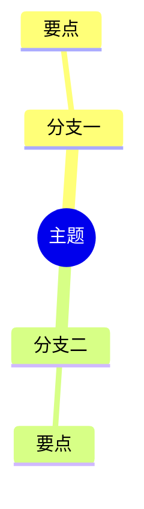
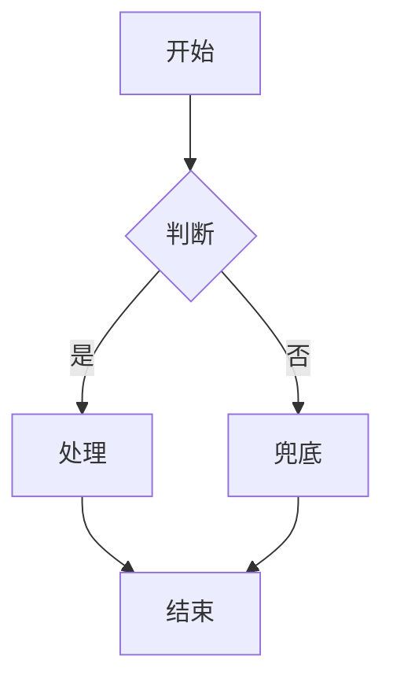
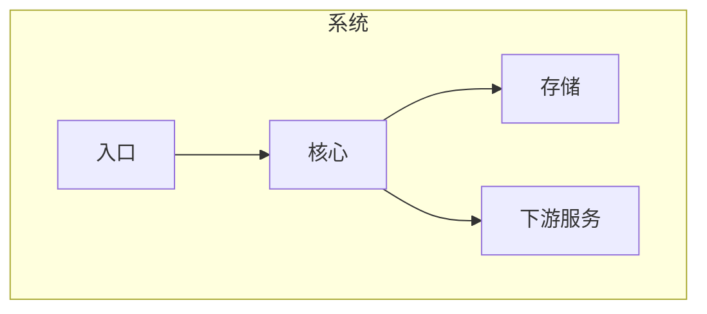
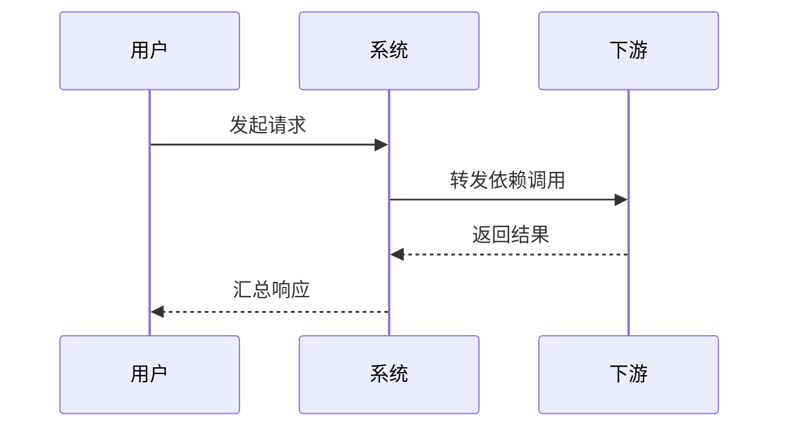

# 交流与文档的内容管理(通用)

本标准两层:**甲 = 面向人类读者的表达层**(怎么呈现,让人宏观理解);**乙 = 面向 agent 的记忆层**(怎么记,让下一个上下文不遗忘、不被噪音污染)。两层共享同一条主原则。甲层见「渐进披露 / 图形表达 / 三种东西 / 过程产物禁入 / 单一事实来源」五节,乙层见「agent 侧」一节,收尾是两层的机器自检。

**一条主原则**:文档按读者分离。给人读的文档,读者默认是**不了解开发过程的人**——要用它的人、要验收它的人、要盘点它的人。凡是只有参与了开发过程的人才需要、才能懂的内容,一律不进正文。

## 渐进披露:总览先行,按需下钻

读者的注意力是稀缺资源:先给全景,再给细节,细节按需展开。

- **对话回复分三层**:第一层 = 一句话结论(+ 一张总图);第二层 = 分点要点;第三层 = 展开细节——只在读者追问或明确需要时给出,不主动灌满。
- **文档分层**:入口页只有导航与一句话定位;每往下一层,信息密度翻倍、目标读者面变窄。
- **改写自查**:超过一屏的说明,先问「它的总览是什么」——没有总览就先造总览,细节挂到总览的节点上,而不是平铺堆砌。

## 图形表达:能用图就不堆文字

选型口诀:发散的知识结构用**脑图**;有分支判断的过程用**流程图**;静态组成用**架构图**;多方消息往来用**时序图**;节点连接关系用**拓扑图**;算法过程用**伪代码**。

**边界**:一句话能说清的不画图;图是总览的载体,不替代结论——渐进披露的第一层永远是「一句话结论(+ 一张总图)」,不是一张没有结论的裸图。

脑图(知识结构全景,一眼看清骨架):



流程图(有分支与判断的过程):



架构 / 拓扑(静态组成与节点连接关系,谁挂在谁下面、谁连着谁):



时序(多方消息往来,谁先谁后、谁请求谁响应):



伪代码(算法与过程逻辑:讲清「怎么算」,又不把读者拖进某种语言的实现细节):

```text
对 每个待办事项:
    若 已有触发条件 且 条件成立 → 排入本轮
    否则若 属显式承诺 → 提醒补触发条件
    否则 → 留在池中,不计数
输出:本轮应做清单(按依赖拓扑排序)
```

规则:伪代码写**意图与控制流**(循环 / 分支 / 产出),不写真实函数签名与文件名——后者是实现细节,属于禁入的实现路径一族。

## 人读文档只写三种东西

1. **可观察行为**:读者做什么、系统怎么响应;
2. **用法**:命令、参数、输入格式;
3. **边界**:不做什么、什么情况例外。

## 过程产物禁入

通用禁词族如下(每族的具体清单由各项目按自己的记号体系定义,写进该项目的文档自检):

| 禁入族 | 为什么 | 边界 |
|---|---|---|
| 追溯记号(需求号 / 任务单号 / 迭代号 / 里程碑号) | 读者不懂编号体系;懂的人也不该被迫依赖它读文档 | 输入格式确需提到时用描述式(「按编号体系填写的单号」),不给具体编号示例 |
| 日期与时点 | 文档会比开发周期活得久,日期必然漂移成误导 | 版本号可以——语义化版本不随时间漂移 |
| 实现内部路径(源码 / 模块文件) | 读者顺着路径去读代码,文档就变成了开发者文档 | 用户可见的安装 / 配置 / 数据位置可以 |
| 过程文档引用(计划 / 决策 / 纪要 / 排期等临时工作文档) | 这些是工作过程的临时产物,不是产品事实 | 系统本身的用户可见数据位置可以 |
| 未决事项与遗留清单 | 未决的事写给人看的文档,就成了对读者的暗示承诺 | 放进项目自己的过程工件,不进人读文档 |

**自查句**:正文每出现一个专有记号,问一次——不参与开发的读者能懂吗?不能,就删掉,或翻译成读者语言。

## 单一事实来源

同一行为的事实只允许一处权威,其余位置只放一行指针。入口文档(索引 / 导航)只做导览、不复制细节——两处都写全,迟早漂移成两处互相矛盾。

## agent 侧:防遗忘的手记形态(给下一个上下文的 agent,不给人读)

手记的读者是 agent 自身,目标是**结构化防遗忘**,不是篇幅。四件套:DAG 任务表、分层索引地图、临时 todos、时效分层(冻结 / 活跃 / 临时)——完整形态与机器可读约定见 `references/agent-notes.md`。

## 机器自检(禁词靠扫描不靠自觉)

落地时配一份自检(退出码即判据),至少覆盖:

1. 篇章文件齐且非空;
2. 导航链接可达,且断言带非空判据(防空集合为真、空壳文档全绿);
3. 禁词扫描零命中——禁词表 = 该项目自己的过程记号体系;
4. 每篇实质内容关键词(点名该篇必讲的内容);
5. 文档主张抽查对回真实行为(file:line 级),对不上就是文档撒谎,改文档或改行为;
6. agent 手记可机读性:DAG 任务表的依赖列 / 索引地图的层级,能被脚本解析(两层的干净都靠机器守)。

> 反馈：本技能来自 [holy-agents-kits](https://github.com/monsterbude123/holy-agents-kits)。发现错误、缺步骤或命令跑不通，直接开 issue：https://github.com/monsterbude123/holy-agents-kits/issues/new
